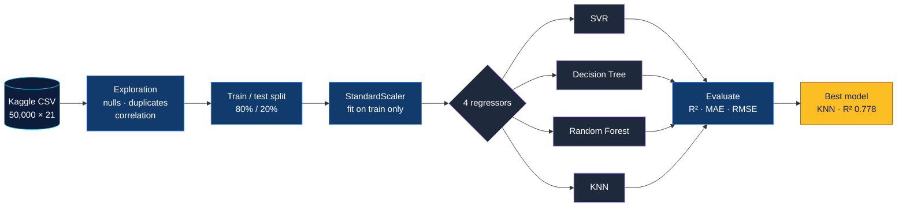

<div align="center">


<br/>

<a href="https://colab.research.google.com/github/sabikswanan/Flood-Probability-Prediction-Using-ML/blob/main/Code%20-%20Flood%20Probability%20Prediction%20using%20ML.ipynb"></a>
<a href="https://www.kaggle.com/datasets/naiyakhalid/flood-prediction-dataset"></a>


<br/><br/>

**[Overview](#overview)** &nbsp;·&nbsp;
**[Dataset](#dataset)** &nbsp;·&nbsp;
**[Pipeline](#pipeline)** &nbsp;·&nbsp;
**[Results](#results)** &nbsp;·&nbsp;
**[Insights](#key-insights)** &nbsp;·&nbsp;
**[Run it](#run-it-yourself)** &nbsp;·&nbsp;
**[Author](#author)**

<br/>


</div>

---

## Overview

Floods are among the most destructive natural disasters, and their risk depends on a mix of climate,
land use, infrastructure and governance. This project asks a simple question:

> **Given 20 risk factors for a region, how well can machine learning predict its flood probability?**

It was built for **CSE437 — Data Science** at **BRAC University**. The notebook explores the data,
prepares it, trains **four regression models** and compares them on **R², MAE and RMSE** to find the
best-performing algorithm.

---

## Dataset

| | |
|---|---|
| **Source** | [Flood Prediction Dataset — Kaggle](https://www.kaggle.com/datasets/naiyakhalid/flood-prediction-dataset) |
| **Rows** | 50,000 regions |
| **Features** | 20 integer risk scores |
| **Target** | `FloodProbability` (continuous, 0–1) |
| **Missing values** | None |
| **Duplicate rows** | None |

<details>
<summary><b>Show all 20 risk factors, grouped by theme</b></summary>
<br/>

| Climate & hydrology | Land use | Infrastructure | Governance & society |
|---|---|---|---|
| MonsoonIntensity | Deforestation | DamsQuality | IneffectiveDisasterPreparedness |
| ClimateChange | Urbanization | DrainageSystems | InadequatePlanning |
| Siltation | AgriculturalPractices | DeterioratingInfrastructure | PoliticalFactors |
| Watersheds | Encroachments | RiverManagement | PopulationScore |
| CoastalVulnerability | TopographyDrainage | | |
| Landslides | | | |
| WetlandLoss | | | |

<sub>The grouping is for readability only; the models use all 20 features as they are.</sub>

</details>

---

## Pipeline



1. **Exploration:** shape, data types, missing values, duplicates, and a full correlation matrix.
2. **Split:** 40,000 rows for training and 10,000 for testing (`random_state = 1`).
3. **Scaling:** `StandardScaler` fitted on the training set only, so no test information leaks in.
4. **Modelling:** Support Vector Regression, Decision Tree, Random Forest and K-Nearest Neighbours.
5. **Evaluation:** R², Mean Absolute Error and Root Mean Squared Error on the held-out test set.

---

## Results

<div align="center">

</div>

<br/>

| Rank | Model | R² ↑ | MAE ↓ | RMSE ↓ |
|:---:|---|:---:|:---:|:---:|
| 🥇 | **K-Nearest Neighbours** | **0.7776** | **0.0186** | **0.0238** |
| 🥈 | Random Forest | 0.7315 | 0.0205 | 0.0261 |
| 🥉 | Support Vector Regression | 0.7090 | 0.0207 | 0.0272 |
| 4 | Decision Tree | 0.1346 | 0.0372 | 0.0469 |

**KNN explains about 78% of the variation in flood probability**, with a typical error of under
two percentage points.

<details>
<summary><b>How does each model work? (one-line explanations)</b></summary>
<br/>

| Model | Idea in one line |
|---|---|
| **KNN** | Predicts a region's flood probability as the average of the 5 most similar regions. |
| **Random Forest** | Averages 100 decision trees, each trained on a random sample of the data. |
| **SVR** | Fits a smooth function that keeps most predictions within a small error margin. |
| **Decision Tree** | Splits the data with yes/no questions until each leaf gives a prediction. |

</details>

---

## What drives flood risk?

<div align="center">

</div>

Every factor correlates with flood probability at almost exactly the same strength (r ≈ 0.22), while
the factors are almost uncorrelated with each other. **No single factor dominates.** Flood risk here
builds up from many small contributions, so a model has to look at all 20 together.

---

## Key insights

- **KNN came out on top (R² 0.778).** Regions with similar risk profiles tend to have similar flood
  probabilities, which is exactly what a neighbour-based model exploits.
- **Ensembles beat single trees by a wide margin.** An unrestricted Decision Tree memorises noise in
  the training data (R² 0.135), while averaging 100 trees in a Random Forest lifts R² to 0.732.
- **Predictions lean towards the average.** In the actual-vs-predicted plot, KNN slightly
  overestimates low-risk regions and underestimates high-risk ones, because averaging neighbours pulls
  extreme values towards the middle.
- **The signal is spread evenly.** All 20 features are about equally correlated with the target and
  barely overlap with each other, so the models use every factor as input.

---

## Visual gallery

<details open>
<summary><b>Plots from the notebook (click to collapse)</b></summary>
<br/>

<table>
  <tr>
    <td align="center"><br/><sub><b>Actual vs. predicted (KNN)</b></sub></td>
    <td align="center"><br/><sub><b>Metric comparison</b></sub></td>
  </tr>
  <tr>
    <td align="center"><br/><sub><b>R² per model</b></sub></td>
    <td align="center"><br/><sub><b>Feature correlation with target</b></sub></td>
  </tr>
  <tr>
    <td colspan="2" align="center"><br/><sub><b>Correlation heatmap — features are nearly independent of one another</b></sub></td>
  </tr>
</table>

</details>

---

## Run it yourself

### Option 1 — Google Colab (no setup)

<a href="https://colab.research.google.com/github/sabikswanan/Flood-Probability-Prediction-Using-ML/blob/main/Code%20-%20Flood%20Probability%20Prediction%20using%20ML.ipynb"></a>

1. Click the badge above to open the notebook.
2. Download the CSV from [Kaggle](https://www.kaggle.com/datasets/naiyakhalid/flood-prediction-dataset).
3. Upload it to Colab's file panel and name it `Dataset - Flood Prediction.csv`.
4. Choose **Runtime → Run all**.

### Option 2 — Run locally

```bash
git clone https://github.com/sabikswanan/Flood-Probability-Prediction-Using-ML.git
cd Flood-Probability-Prediction-Using-ML
pip install pandas numpy scikit-learn matplotlib seaborn jupyter
jupyter notebook
```

<details>
<summary><b>Running locally? Change one line first</b></summary>
<br/>

The notebook reads the dataset from Colab's `/content/` folder. Put the CSV next to the notebook
and update the path in the first data cell:

```python
df = pd.read_csv("Dataset - Flood Prediction.csv")
```

</details>

---

## Project structure

```text
Flood-Probability-Prediction-Using-ML/
├── Code - Flood Probability Prediction using ML.ipynb   # full analysis and models
├── README.md
└── assets/
    ├── *.svg          # animated graphics used in this README
    └── plots/         # figures exported from the notebook
```

---

## Future work

- [ ] Try **Linear and Ridge Regression**, since every feature contributes almost equally to the target
- [ ] Tune hyperparameters (number of neighbours for KNN, tree depth, SVR kernel) with **k-fold cross-validation**
- [ ] Add **gradient boosting** models such as XGBoost
- [ ] Explain individual predictions with **SHAP values**
- [ ] Deploy a small web app where users enter risk scores and get a flood probability

---

## Author

<div align="center">

**Sabik Swanan**<br/>
B.Sc. in Computer Science · BRAC University<br/>
<sub>CSE437 — Data Science</sub>

<br/>

<a href="https://github.com/sabikswanan"></a>
<a href="https://www.linkedin.com/in/sabikswanan"></a>
<a href="mailto:sabikswanan@gmail.com"></a>

<br/><br/>

<sub>If this project helped you, consider giving it a ⭐</sub>


</div>
