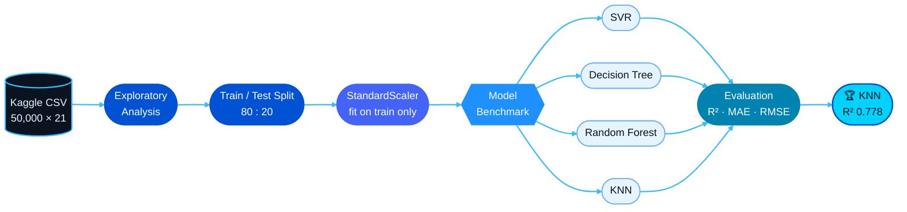
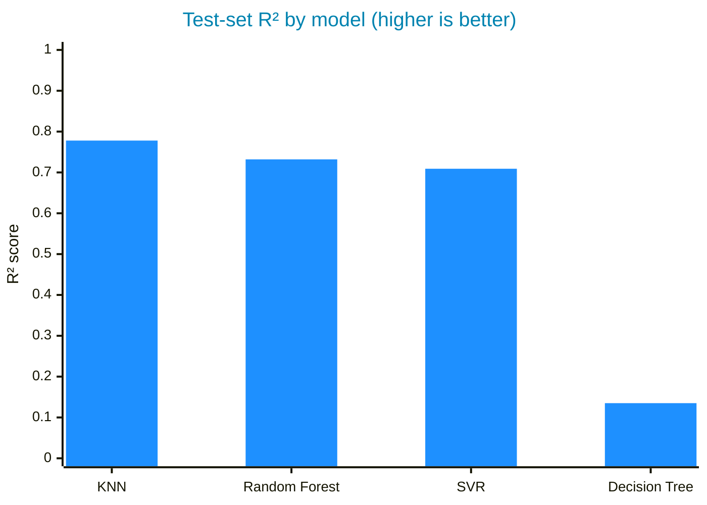
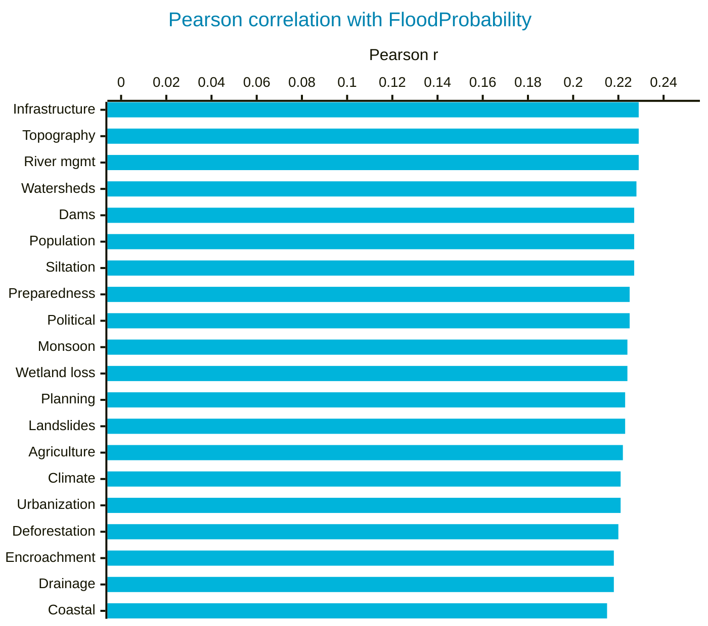

<div align="center">


<a href="https://github.com/sabikswanan/Flood-Probability-Prediction-Using-ML"></a>

<br/>


<a href="https://colab.research.google.com/github/sabikswanan/Flood-Probability-Prediction-Using-ML/blob/main/Code%20-%20Flood%20Probability%20Prediction%20using%20ML.ipynb"></a>
<a href="https://www.kaggle.com/datasets/naiyakhalid/flood-prediction-dataset"></a>


<br/><br/>

**[Overview](#overview)** &nbsp;|&nbsp;
**[Dataset](#dataset)** &nbsp;|&nbsp;
**[Pipeline](#pipeline)** &nbsp;|&nbsp;
**[Results](#results)** &nbsp;|&nbsp;
**[Insights](#insights)** &nbsp;|&nbsp;
**[Getting Started](#getting-started)** &nbsp;|&nbsp;
**[Author](#author)**

</div>

<br/>

<a name="overview"></a>

## 🌊 Overview

Floods are among the most destructive natural disasters, and their risk depends on a combination of
climate, land use, infrastructure and governance factors. This project answers one question:

> [!NOTE]
> **Given 20 risk factors for a region, how accurately can machine learning predict its flood probability?**

Built for **CSE437 — Data Science** at **BRAC University**, the notebook covers the full workflow:
exploratory analysis, preprocessing, training **four regression models**, and benchmarking them on
**R², MAE and RMSE** to select the best-performing algorithm.

<br/>

<a name="dataset"></a>

## 📦 Dataset

| Property | Value |
|---|---|
| **Source** | [Flood Prediction Dataset — Kaggle](https://www.kaggle.com/datasets/naiyakhalid/flood-prediction-dataset) |
| **Rows** | 50,000 regions |
| **Features** | 20 integer risk scores |
| **Target** | `FloodProbability` (continuous, 0–1) |
| **Missing values** | None |
| **Duplicate rows** | None |

<details>
<summary><b>View all 20 risk factors, grouped by domain</b></summary>
<br/>

| Climate & Hydrology | Land Use | Infrastructure | Governance & Society |
|---|---|---|---|
| MonsoonIntensity | Deforestation | DamsQuality | IneffectiveDisasterPreparedness |
| ClimateChange | Urbanization | DrainageSystems | InadequatePlanning |
| Siltation | AgriculturalPractices | DeterioratingInfrastructure | PoliticalFactors |
| Watersheds | Encroachments | RiverManagement | PopulationScore |
| CoastalVulnerability | TopographyDrainage | | |
| Landslides | | | |
| WetlandLoss | | | |

<sub>Grouping is for readability only; all 20 features are used as model inputs.</sub>

</details>

<br/>

<a name="pipeline"></a>

## ⚙️ Pipeline



| Stage | Details |
|---|---|
| **Exploratory analysis** | Shape, data types, missing values, duplicates and a full correlation matrix |
| **Split** | 40,000 training rows and 10,000 test rows (`random_state = 1`) |
| **Scaling** | `StandardScaler` fitted on the training set only to prevent data leakage |
| **Modelling** | Support Vector Regression, Decision Tree, Random Forest, K-Nearest Neighbours |
| **Evaluation** | R², Mean Absolute Error and Root Mean Squared Error on the held-out test set |

<br/>

<a name="results"></a>

## 🏆 Results



| Rank | Model | R² ↑ | MAE ↓ | RMSE ↓ |
|:---:|---|:---:|:---:|:---:|
| 🥇 | **K-Nearest Neighbours** | **0.7776** | **0.0186** | **0.0238** |
| 🥈 | Random Forest | 0.7315 | 0.0205 | 0.0261 |
| 🥉 | Support Vector Regression | 0.7090 | 0.0207 | 0.0272 |
| 4 | Decision Tree | 0.1346 | 0.0372 | 0.0469 |

> [!TIP]
> **KNN explains ~78% of the variance in flood probability**, with a mean absolute error of under
> two percentage points on 10,000 unseen regions.

<details>
<summary><b>How each model works</b></summary>
<br/>

| Model | Approach |
|---|---|
| **K-Nearest Neighbours** | Predicts a region's flood probability as the average of its 5 most similar regions. |
| **Random Forest** | Averages 100 decision trees, each trained on a bootstrap sample of the data. |
| **Support Vector Regression** | Fits a smooth function that keeps most predictions within a small error margin. |
| **Decision Tree** | Recursively splits the data on feature thresholds until each leaf yields a prediction. |

</details>

### 📈 Feature correlation with the target



All 20 factors correlate with flood probability at nearly identical strength (r ≈ 0.22), while being
almost uncorrelated with one another. **No single factor dominates** — risk accumulates from many
small contributions, so the model must consider all 20 together.

<br/>

<a name="insights"></a>

## 💡 Key Insights

<table>
  <tr>
    <td width="50%" valign="top">
      <h4>🎯 KNN performs best</h4>
      R² <b>0.778</b>. Regions with similar risk profiles have similar flood probabilities, which a
      neighbour-based model exploits directly.
    </td>
    <td width="50%" valign="top">
      <h4>🌲 Ensembles beat single trees</h4>
      An unrestricted Decision Tree overfits (R² <b>0.135</b>); averaging 100 trees in a Random
      Forest raises R² to <b>0.732</b>.
    </td>
  </tr>
  <tr>
    <td width="50%" valign="top">
      <h4>📉 Predictions regress to the mean</h4>
      KNN slightly overestimates low-risk regions and underestimates high-risk ones, as neighbour
      averaging pulls extremes toward the centre.
    </td>
    <td width="50%" valign="top">
      <h4>🧩 Signal is evenly distributed</h4>
      Every feature is roughly equally correlated with the target and largely independent of the
      others, so all 20 are kept as inputs.
    </td>
  </tr>
</table>

> [!NOTE]
> Full visualisations — correlation heatmap, actual-vs-predicted scatter and metric comparisons — are
> available in the [notebook](Code%20-%20Flood%20Probability%20Prediction%20using%20ML.ipynb).

<br/>

<a name="getting-started"></a>

## 🚀 Getting Started

**Option 1 — Google Colab (no setup)**

1. Open the notebook with the **Open in Colab** badge at the top.
2. Download the CSV from [Kaggle](https://www.kaggle.com/datasets/naiyakhalid/flood-prediction-dataset).
3. Upload it to Colab's file panel as `Dataset - Flood Prediction.csv`.
4. Select **Runtime → Run all**.

**Option 2 — Local environment**

```bash
git clone https://github.com/sabikswanan/Flood-Probability-Prediction-Using-ML.git
cd Flood-Probability-Prediction-Using-ML
pip install pandas numpy scikit-learn matplotlib seaborn jupyter
jupyter notebook
```

<details>
<summary><b>Note for local runs</b></summary>
<br/>

The notebook reads the dataset from Colab's `/content/` directory. Place the CSV next to the notebook
and update the path in the first data cell:

```python
df = pd.read_csv("Dataset - Flood Prediction.csv")
```

</details>

<br/>

## 🗺️ Roadmap

- [ ] Benchmark **Linear and Ridge Regression**, given the near-additive structure of the features
- [ ] Hyperparameter tuning (k for KNN, tree depth, SVR kernel) with **k-fold cross-validation**
- [ ] Add **gradient boosting** models such as XGBoost
- [ ] Model explainability with **SHAP**
- [ ] Deploy as a lightweight web service for interactive flood-risk scoring

<br/>

<a name="author"></a>

## 👤 Author

<div align="center">

### Sabik Swanan

B.Sc. in Computer Science · BRAC University

<br/>

<a href="https://github.com/sabikswanan"></a>
<a href="https://www.linkedin.com/in/sabikswanan"></a>
<a href="https://mail.google.com/mail/?view=cm&fs=1&to=sabikswanan@gmail.com"></a>

<br/><br/>

<sub>⭐ Star this repo if you found it useful</sub>


</div>
